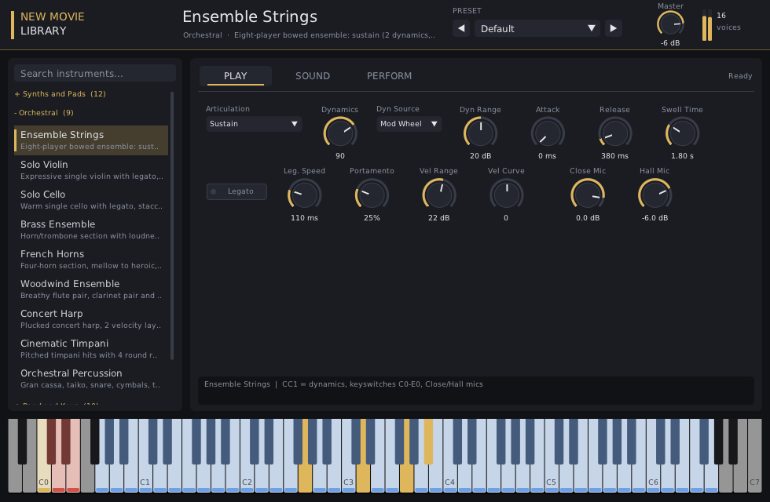

# New Movie Library: a cinematic sample library for Kontakt 8, a VST3/CLAP plugin and free samplers

An original sample library for film, trailer and game scoring. It has **45 instruments** in five
categories, **1,527 samples** (24-bit / 44.1 kHz, about 464 MB), and four ways to play them:

| Use it in | What you get | Start here |
|---|---|---|
| **Any DAW (Windows, Linux)** | The *New Movie Library* player plugin (VST3 + CLAP). It plays all 45 instruments with the same controls as the Kontakt version. No Kontakt needed. | [Plugin/README.md](Plugin/README.md) |
| **Kontakt 8** | A Kontakt library layout: scripted performance views, articulations, keyswitches, mic mixes, presets and effects. You build the `.nki` files once with Creator Tools. | [Build Guide](New%20Movie%20Library/Documentation/BUILD%20GUIDE.md) |
| **Free samplers** | SFZ (sfizz, sforzando, ...) and Decent Sampler versions of every instrument | [SFZ and Decent Sampler](New%20Movie%20Library/Documentation/SFZ%20AND%20DECENT%20SAMPLER.md) |
| **Your DAW's piano roll** | 36 MIDI phrases (progressions, ostinatos, grooves, themes) plus 8 multi recipes | [Multis and MIDI](New%20Movie%20Library/Documentation/MULTIS%20AND%20MIDI.md) |



> **Every sound here is original.** All samples are synthesized from scratch by
> the Python code in [`tools/`](tools/): oscillators, physical string models,
> modal synthesis, formant synthesis and synthetic reverbs. Nothing is copied
> from Native Instruments' factory content or any other commercial library. The
> genuine Kontakt 8 factory library comes with Kontakt 8 or Komplete through
> Native Access, and the free Kontakt 8 Player includes a Factory Selection.

## Quick start on Windows (no Kontakt needed)

1. On GitHub choose **Code > Download ZIP**, then unzip it. Keep the `New Movie Library` and
   `Plugin` folders side by side.
2. Double-click `Plugin\Windows\New Movie Library Setup.exe` and follow the wizard (allow the
   administrator prompt; pick where the samples go).
3. In your DAW, rescan plugins and load **New Movie Library** on an instrument track.
4. Pick an instrument in the browser on the left and play.

## What's inside

| Category | Instruments |
|---|---|
| **01 Synths and Pads** (12) | Warm Analog Pad, Glass Shimmer Pad, Wavetable Pad, Supersaw Stack, Analog Brass Synth, Analog Mono Bass, 808 Bass, Tape Keys, Pluck Synth, Pulse Arp, Sequencer Bass, Ethereal Choir |
| **02 Orchestral** (9) | Ensemble Strings, Solo Violin, Solo Cello, Brass Ensemble, French Horns, Woodwind Ensemble, Concert Harp, Cinematic Timpani, Orchestral Percussion |
| **03 Band and Keys** (10) | Felt Piano, Electric Piano, Drawbar Organ, Nylon Guitar, Electric Guitar, Finger Bass, Studio Drum Kit, Synthwave Kit, Trap Kit, Cinematic Mallets |
| **04 Cinematic** (8) | Braams and Hits, Drones and Textures, Dark Atmospheres, Reverse Swells, Cinematic FX, Hybrid Trailer Percussion, Sci-Fi FX, Tension Toolkit |
| **05 World** (6) | Hang Drum, Steel Pan, Kalimba, Gamelan Bells, Sitar and Tanpura, Duduk |

The [Instrument Guide](New%20Movie%20Library/Documentation/INSTRUMENT%20GUIDE.md) gives the details
of every instrument: ranges, keyswitches, key maps, layers, round robins, presets, effects and file names.

### Every instrument has a full performance view

- **PLAY page:** the controls for that engine.
  - **Synth engine:** two blendable layers, filter Movement synced to tempo, octave stacks, mono/glide.
  - **Articulation engine:** keyswitched articulations, mod-wheel dynamics crossfades, legato with
    portamento, close and hall microphones, round-robin shorts.
  - **Keys engine:** velocity layers (up to 3), round robins, layering, let ring, velocity curves.
  - **Drum engine:** a bus mixer, choke groups, humanize, kit spread and tempo-synced **Note Repeat**.
- **SOUND page:** an effects chain built by the script: Filter, Stereo Modeller, Choral,
  Replika delay (tempo-synced) and Raum reverb. Some instruments add EP Preamp, Rotator,
  Supercharger GT or Bus Compressor.
- **PERFORM page** (all melodic instruments):
  - Scale Lock (16 scales)
  - Chords (17 types, including diatonic triads and 7ths)
  - Strum
  - a tempo-synced Arpeggiator (6 modes, 1/4 to 1/32 with triplets)
  - Humanize
- **Presets:** each instrument has 2 to 5 presets plus *Default*, in the menu at the top right.

[Controls](New%20Movie%20Library/Documentation/CONTROLS.md) explains every knob.

## Folder layout

```
New Movie Library/
├── Instruments/            save the Kontakt .nki files here (one folder per category)
├── Multis/                 save Kontakt multis (.nkm) here
├── Samples/                1,527 WAVs:  <Category>/<Instrument>/<Group>/<file>.wav
├── SFZ/                    81 .sfz instruments (use the samples above)
├── Decent Sampler/         94 .dspreset presets (use the samples above)
├── MIDI/                   36 MIDI phrases in 7 folders
├── Resources/
│   ├── scripts/            the Kontakt performance script of every instrument (.txt)
│   ├── ir_samples/         4 bonus impulse responses for Kontakt's Convolution effect
│   └── pictures/           category wallpapers (Kontakt and Decent Sampler)
├── Creator Tools/          one Lua build script per instrument
└── Documentation/          Build Guide, Instrument Guide, Controls, Multis and MIDI,
                            SFZ and Decent Sampler, manifest.json
Plugin/                     the ready-to-install player plugin (Windows + Linux) and its guide
plugin-src/                 the plugin source (C++, DPF + Dear ImGui) and its tests
tools/                      the Python generator (samples, scripts, formats, docs) + QA and tests
```

Each sample's name carries its mapping: `<Instrument>_<Group>_<root>_<low key>_<high key>_<low vel>_<high vel>.wav`.
Loop points and root key are also embedded in the WAV `smpl` chunk.

## Kontakt quick start

Kontakt instrument files (`.nki`) can only be written by Kontakt itself, so
each instrument is built once with **Creator Tools** (free, installed with
Kontakt 8). It takes about a minute per instrument:

1. In Kontakt 8, double-click the empty rack area to create an empty instrument.
2. Open **Creator Tools**, select that instrument in the Instrument Editor and
   run `New Movie Library/Creator Tools/Build <Instrument>.lua` in the
   **Lua Script** panel. Press **Run**, then **Push**.
3. Save it as `New Movie Library/Instruments/<Category>/<Instrument>.nki`.

The script creates every group, maps every zone, sets the loop points and attaches the
performance script. The [Build Guide](New%20Movie%20Library/Documentation/BUILD%20GUIDE.md)
covers wallpapers, multis, a manual method without Creator Tools, and troubleshooting.

## Rebuilding or changing the sounds

Everything is generated reproducibly. See [`tools/README.md`](tools/README.md).

```bash
pip install -r tools/requirements.txt
python3 tools/build_library.py          # renders all samples + scripts + formats + docs
python3 tools/qa_report.py              # clipping / DC / pitch / loop-seam checks
python3 tools/test_build_scripts.py     # dry-runs every Creator Tools script
sh tools/build_plugin.sh                # builds the plugin for Linux + Windows
```

## Your own recordings

The library is built from code, so adding your own recordings (a real violin, your voice,
field recordings) works too. Send the WAV files: they can be mapped, looped and wrapped in
the same scripts, plugin, SFZ and Decent Sampler formats as the rest of the library.

## Status and honest limits

- **Tested here:**
  - Every Kontakt script compiles with the SublimeKSP compiler's extra syntax checks.
  - Every Lua build script was dry-run against a mock of the Creator Tools API.
  - Every sample passed QA: no clipping, no DC offset, seamless loops, tuned within a few cents.
  - The plugin was built for Linux and Windows. It was tested in a CLAP test host on Linux and on
    Windows (under Wine), with audio, state save/restore and its window clicked through.
    The VST3 was tested in a JUCE-based host.
  - The plugin engine runs all 45 instruments clean under Valgrind.
  - Every SFZ file was checked and played in sfizz.
- **Not tested here:**
  - Kontakt itself, the Windows VST3 inside a real Windows DAW, and Decent Sampler itself,
    because none of them could run in this build environment.
  - If something misbehaves, note the message and the instrument; the generators in `tools/`
    and `plugin-src/` fix every instrument at once.
- The orchestral and band instruments are **synthesized and modeled**, not
  recorded. They work well for sketching, hybrid and synth-orchestral scoring,
  but they won't match the realism of libraries recorded with live players.
